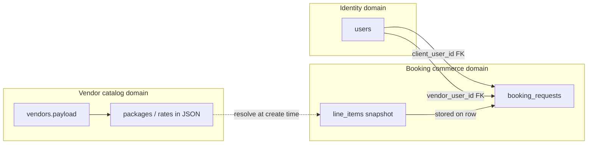

# Day 2 — How to Model a Real-World Problem

**Status:** in progress (awaiting Step 9 answer + Step 12 exit ticket)

---

## Step 1 — Objective

After today you can look at an Eventtz feature and name its **entities**, **relationships**, and **domain boundaries**, and you can decide whether a piece of data should stay **live** (read from the source) or be stored as a **snapshot** (frozen at a moment in time).

---

## Step 2 — Recap

On Day 1 you learned how Eventtz is organized: a user action hits a **route**, a **feature module** does the work, **contracts** define the shapes crossing the wire, and **SQL migrations** define what Postgres stores.

Today we go one layer deeper: before you write a route or a migration, you ask *what things exist in the real world* and *how they connect*. That question is **domain modeling** — and Eventtz already made modeling choices you can study.

---

## Step 3 — Hook

A client browses a photographer's profile and selects the **"Full-day wedding"** package at **£1,800**. They submit a booking enquiry.

Three days later the photographer renames the package to **"Premium wedding coverage"** and raises the price to **£2,100**.

The client opens their pending enquiry. **What should they see?**

- The name and price from enquiry day (what they agreed to explore), or
- The photographer's current listing (what's on the marketplace today)?

That tension — *live catalog vs frozen deal terms* — is the heart of today's lesson.

---

## Step 4 — Concept

**Modeling** means naming the nouns in your problem (entities), how they link (relationships), and which team or module owns each noun (domain boundaries).

Not every noun gets its own table. Sometimes the right model is:

| Strategy | Meaning | When to use |
|----------|---------|-------------|
| **Live reference** | Store an ID; read current data from the source table at display time | Source changes should flow through (e.g. vendor display name on a list row) |
| **Snapshot** | Copy the important fields into the record at write time | The deal/legal/history meaning must not change when the source changes |

Eventtz's booking flow uses **both**: `booking_requests` stores foreign keys to `users` (live identity) but copies package details into `line_items` JSON (snapshot of the commercial offer).

---

## Step 5 — Vocabulary

| Term | Meaning |
|------|---------|
| **Entity** | A distinct thing with identity that persists over time (User, Vendor, BookingRequest). |
| **Relationship** | How entities link (client *creates* booking, booking *references* vendor). |
| **Domain boundary** | A line around one area of the product; data inside is owned by one feature team/module. |
| **Snapshot data** | A copy of fields frozen at a point in time; immune to later edits at the source. |
| **Live data** | Read from the authoritative source when needed; always reflects current state. |
| **Contract** | A typed shape (Pydantic / TypeScript) for data crossing an API boundary. |
| **Domain types** | Shared UI vocabulary (`frontend/lib/domain-types.ts`) so client and vendor portals speak the same language. |

All terms are in [`GLOSSARY.md`](../GLOSSARY.md).

---

## Step 6 — Mental Model

Think of Eventtz as three neighborhoods with a bridge:



**Rules of thumb:**

1. **IDs cross boundaries; blobs snapshot when the deal matters.**
2. **Contracts** sit on the API edge — they describe what leaves a feature, not necessarily how Postgres normalizes it.
3. If changing the vendor profile tomorrow would confuse a client about what they enquired on yesterday → snapshot.

---

## Step 7 — Code Safari

### 7a — Entities in SQL: users and vendors

`001_users_and_vendor_onboarding.sql` defines two core entities:

- `users` — one row per auth user (client, vendor, or admin)
- `vendors` — one row per vendor account; profile lives in `payload` JSONB

```35:50:backend/sql/001_users_and_vendor_onboarding.sql
CREATE TABLE IF NOT EXISTS public.vendors (
  id uuid PRIMARY KEY DEFAULT gen_random_uuid(),
  user_id uuid NOT NULL UNIQUE REFERENCES public.users (id) ON DELETE CASCADE,
  status text NOT NULL DEFAULT 'draft'
    CHECK (status IN ('draft', 'submitted', 'complete')),
  current_step integer NOT NULL DEFAULT 1
    CHECK (current_step >= 1 AND current_step <= 20),
  payload jsonb NOT NULL DEFAULT '{}'::jsonb,
  ...
);

COMMENT ON COLUMN public.vendors.payload IS
  'JSON snapshot of vendor profile form (strings, numbers, booleans, string arrays). Files: store storage paths when upload exists.';
```

**Boundary:** vendor onboarding owns `vendors.payload`. Marketplace search reads it; booking does not store the whole payload on each enquiry.

### 7b — Booking entity: relationships + snapshot column

`010_booking_requests.sql` introduces the commerce entity:

```4:30:backend/sql/010_booking_requests.sql
CREATE TABLE IF NOT EXISTS public.booking_requests (
  id uuid PRIMARY KEY DEFAULT gen_random_uuid(),
  client_user_id uuid NOT NULL REFERENCES public.users (id) ON DELETE CASCADE,
  vendor_user_id uuid NOT NULL REFERENCES public.users (id) ON DELETE CASCADE,
  ...
  selected_option_ids text[] NOT NULL DEFAULT '{}',
  line_items jsonb NOT NULL DEFAULT '[]'::jsonb,
  total_label text NOT NULL,
  ...
);

COMMENT ON TABLE public.booking_requests IS
  'Client-initiated booking enquiry; line_items/selected_option_ids snapshot vendor payload ids.';
```

Notice the mix:

- **Relationships (live):** `client_user_id`, `vendor_user_id` → still valid if the vendor renames their business (you re-fetch display name).
- **Snapshot:** `line_items` JSONB — priced package rows copied at enquiry time.
- **Hybrid:** `selected_option_ids` — IDs from the vendor profile at selection time; useful for debugging/analytics but not sufficient alone (IDs could be reused or packages removed).

### 7c — Contracts: the shape of a line item

`backend/app/contracts/booking.py` defines what a line item *means* at the API layer:

```13:24:backend/app/contracts/booking.py
class BookingLineItemIn(BaseModel):
    id: str
    heading: str = Field(min_length=1, max_length=200)
    unit_price_gbp: float | None = None
    description: str | None = Field(default=None, max_length=4000)
    feature_lines: list[str] = Field(default_factory=list, max_length=25)
    timeline_line: str | None = Field(default=None, max_length=500)
```

The contract is stable even though vendor packages live inside unstructured `vendors.payload`.

### 7d — Write path: resolve live catalog → persist snapshot

When a client creates a booking, the feature reads **live** vendor payload, builds line items, then **inserts the snapshot**:

```201:240:backend/app/features/bookings/create.py
    payload = get_approved_vendor_payload(vendor_user_id)
    ...
    line_items = resolve_line_items(payload, selected_option_ids)
    line_items = line_items + compute_automatic_discount_lines(payload, line_items, event_date)
    ...
    row_out: dict[str, Any] = {
        ...
        "selected_option_ids": selected_option_ids,
        "line_items": line_items,
        "total_label": persisted_booking_total_label(pb),
        ...
    }
```

`resolve_line_items` in `list_pricing.py` walks the vendor's current packages and maps selected IDs to priced rows — that happens **once at create time**, not on every read.

### 7e — Read path: trust the row

Detail queries load `line_items` from `booking_requests` and compute pricing from the stored snapshot (`queries.py` → `_attach_pricing_fields`). They do **not** re-join `vendors.payload` to rebuild the quote.

### 7f — Domain types on the frontend

`frontend/lib/domain-types.ts` centralizes booking vocabulary (status colors, pricing breakdown shape) so client and vendor UIs stay aligned — mirroring contracts on the backend.

---

## Step 8 — Guided Exercise

Open `backend/sql/010_booking_requests.sql` and `backend/app/features/bookings/create.py`.

For a **client-initiated enquiry**, fill in this table (write your answers in chat or on paper):

| Field on `booking_requests` | Entity or snapshot? | Live source (if not snapshot) |
|-----------------------------|---------------------|----------------------------------|
| `client_user_id` | ? | ? |
| `vendor_user_id` | ? | ? |
| `event_name` | ? | ? |
| `line_items` | ? | ? |
| `total_label` | ? | ? |
| `selected_option_ids` | ? | ? |

*Hint:* Ask "If the vendor edits their profile tomorrow, should this field change for an old booking?"

---

## Step 9 — Break-It Scenario ⏸️

**Stop here. Answer before reading the debrief below.**

---

### The question

`booking_requests.line_items` is a **JSONB column** holding full package rows (heading, price, description, etc.).

An alternative design would store only `selected_option_ids` and **JOIN** (or re-resolve) `vendors.payload` every time someone opens the booking detail page.

**Why does Eventtz snapshot `line_items` into the booking row instead of joining vendor tables at read time?**

Write your answer in your own words — bullet points are fine. Mention at least:

1. What could go wrong for the **client** if prices/names were always live.
2. What could go wrong for the **vendor** or **payments** if history were not frozen.

---

> **Teacher note:** The debrief for this scenario is intentionally omitted from this section until the student responds. See [`_SPINOFF_RULES.md`](_SPINOFF_RULES.md).

---

## Step 10 — Common Mistakes

1. **Normalizing everything.** Creating `booking_line_items` with FKs to `vendor_packages` feels "clean" but breaks when vendors delete or rewrite packages. Snapshots trade purity for correctness.

2. **Snapshotting everything.** Storing a copy of the vendor's entire profile on each booking would bloat rows and stale-copy PII. Eventtz snapshots only the commercial slice (`line_items`).

3. **Confusing contracts with tables.** `BookingLineItemIn` is not a database table — it's the API shape. The table column is `jsonb`.

4. **Using IDs without snapshots for money.** `selected_option_ids` alone is not enough for disputes — the ID might point at a changed or removed package.

5. **Crossing domain boundaries silently.** Booking code reaching into vendor payload on **every read** couples commerce to catalog and makes payout/adjustment logic harder to reason about.

---

## Step 11 — Self-Check

1. Name the three entities involved when a client sends a booking enquiry to a vendor.

2. Is `vendors.payload` live or snapshot data? Who owns that domain?

3. When a vendor sends a **custom quote** (`create_vendor_quote_booking_request`), what goes into `line_items` and `selected_option_ids`?

---

### Answers (only peek after you try)

1. **User** (client), **User** (vendor), **BookingRequest** — optionally **ClientEvent** if linked. The commercial packages are not separate tables; they're values inside vendor payload until copied.

2. **Live** (mutable profile). Owned by the **vendor onboarding / profile** domain (`vendors` table, `features/vendors/`).

3. Vendor-authored line items go into `line_items` (snapshot of the quote). `selected_option_ids` is `[]` because the client did not pick from the catalog — the vendor defined custom rows.

---

## Step 12 — Your Turn (exit ticket)

Explain today's concept in your own words:

> *"When I model a feature in Eventtz, I …"*

Cover: entities, relationships, domain boundaries, and when to snapshot vs read live.

**The teacher will not mark Day 2 complete until you submit this.**

---

## Debrief placeholder — Break-It Scenario

*To be filled in by the teacher after the student answers Step 9.*
